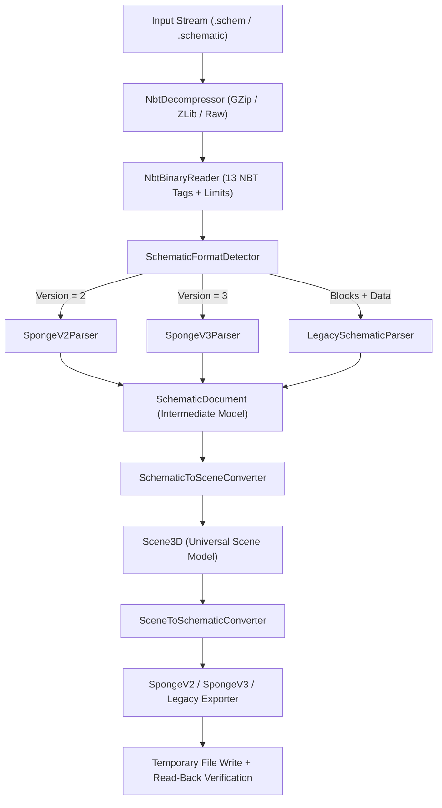

# Kiến Trúc Schematic Engine – NEXUS 3D (Giai đoạn 03)

## 1. Tổng Quan Kiến Trúc

`NEXUS3D.Formats.Schematic` là module chuyên trách đọc, phân tích cú pháp, kiểm tra tính toàn vẹn, chuyển đổi hai chiều với **Universal Scene Model (USM)** và xuất các định dạng Minecraft Schematic:

- **Sponge Schematic Version 2** (`.schem`, Minecraft 1.13+)
- **Sponge Schematic Version 3** (`.schem`, cấu trúc phân tách `Blocks` / `Biomes` / `Entities`)
- **Legacy MCEdit / WorldEdit Schematic** (`.schematic`, Pre-1.13 / 1.12.2 Alpha format)

## 2. Phân Tách Trách Nhiệm Các Phân Lớp

| Phân hệ | Namespace | Trách nhiệm chính |
|---|---|---|
| **NBT Engine** | `NEXUS3D.Formats.Schematic.Nbt.*` | Giải nén/nén GZip & ZLib, đọc/ghi 13 loại tag NBT (Big-Endian & Little-Endian), kiểm soát giới hạn bảo mật (`NBT001`–`NBT005`). |
| **Common Schematic Model** | `NEXUS3D.Formats.Schematic.Common` | `SchematicDocument`, `SchematicDimensions`, `SchematicOffset`, `SchematicIndexing` (`YZX`), `SchematicReadOptions`, `SchematicWriteOptions`, `SchematicErrorCodes` (`SCH001`–`SCH016`). |
| **BlockState Engine** | `NEXUS3D.Formats.Schematic.BlockStates` | Phân tích cú pháp và chuẩn hóa chuỗi `namespace:name[prop1=val1,prop2=val2]` (`BlockStateParser`, `BlockStateFormatter`, `ResourceLocation`). |
| **Palette & VarInt** | `NEXUS3D.Formats.Schematic.Palette` | Mã hóa/giải mã VarInt 7-bit (`VarIntDecoder`, `VarIntEncoder`), quản lý bảng màu khối (`SchematicPalette`, `PaletteDecoder`, `PaletteEncoder`). |
| **BlockEntity Engine** | `NEXUS3D.Formats.Schematic.BlockEntities` | Đọc/ghi `BlockEntities` (Sponge v2/v3) và `TileEntities` (Legacy), ánh xạ sang `BlockEntityData` + `RawDataContainer` nhị phân để không mất NBT tùy chỉnh. |
| **Sponge v2/v3 Engine** | `NEXUS3D.Formats.Schematic.Sponge` | `SpongeSchematicDetector`, `SpongeV2Parser`, `SpongeV3Parser`, `SpongeV2Exporter`, `SpongeV3Exporter`. |
| **Legacy Engine** | `NEXUS3D.Formats.Schematic.Legacy` | `LegacySchematicDetector`, `LegacyBlockDecoder`/`Encoder` (`Blocks` + `AddBlocks` 12-bit), `LegacyMetadataDecoder`/`Encoder` (nibble 4-bit), `LegacyBlockIdMapping`. |
| **USM Conversion** | `NEXUS3D.Formats.Schematic.Conversion` | `SchematicToSceneConverter`, `SceneToSchematicConverter`, `SchematicDataPreserver` (bảo toàn `Biomes`, `Entities`, `UnmappedRootTags`). |
| **Public Services** | `NEXUS3D.Formats.Schematic.Services` | `ISchematicFormatDetector`, `ISchematicReader`, `ISchematicWriter`, `SchematicServiceRegistration`. |

## 3. Cơ Chế Xuất File An Toàn (Atomic File Export)

`SchematicFormatExporter.WriteDocumentToFileAsync` thực thi quy trình 3 bước:
1. Ghi dữ liệu ra file tạm `<target>.<guid>.tmp` cùng thư mục.
2. Đọc ngược lại file tạm bằng `SchematicFormatParser` để xác minh cấu trúc NBT, kích thước `Dimensions` và `Palette`.
3. Chỉ khi xác minh thành công mới thực hiện `File.Move(..., overwrite: AllowOverwrite)` thay thế file đích; nếu lỗi, xóa file tạm và giữ nguyên file gốc.

