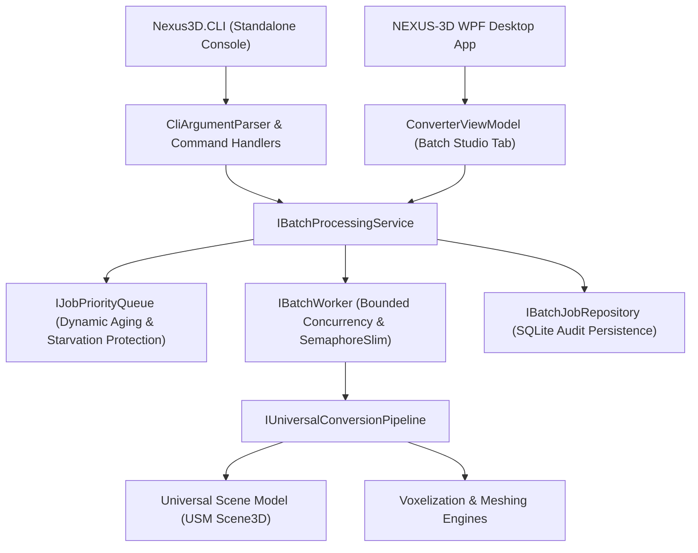

# NEXUS-3D – Batch Processing & CLI Architecture Specification

## 1. Executive Summary

Phase 10 introduces the enterprise-grade **Batch Processing Engine** and standalone **Command Line Interface (`Nexus3D.CLI`)** for NEXUS-3D. Built on .NET 10 LTS and Clean Architecture principles, this system enables high-throughput, bounded-concurrency model conversions across all supported 3D and voxel formats (`.obj`, `.schem`, `.schematic`, `.voxel.json`, `.geo.json`) through the intermediate **Universal Scene Model (USM)**.



---

## 2. Core Architectural Components

### 2.1. Priority Queue & Starvation Prevention (`JobPriorityQueue`)
The scheduling engine implements a priority queue supporting four priority tiers:
1. `Critical (0)`: Highest priority, preempts normal tasks.
2. `High (1)`: Priority batch workloads.
3. `Normal (2)`: Default user-initiated conversions.
4. `Low (3)`: Background maintenance and bulk archival runs.

#### Starvation Prevention Algorithm
To prevent low-priority jobs from being starved during heavy loads, the scheduler evaluates a dynamic **Effective Priority Score**:
$$\text{EffectiveScore} = \max\left(0, \text{Priority} - \left\lfloor \frac{\text{ElapsedSeconds}}{\text{AgingInterval}} \right\rfloor\right)$$

- Every aging interval (configured to 15 seconds), waiting jobs are promoted by 1 effective priority level.
- Within the same effective score tier, tasks strictly follow **FIFO (First-In-First-Out)** ordering by `EnqueuedAtUtc`.

### 2.2. Bounded Concurrency & Worker Engine (`BatchWorker`)
- Concurrency is throttled using `SemaphoreSlim(maxConcurrency)` where `maxConcurrency` defaults to 4 and scales up to `Environment.ProcessorCount` or configured parallelism (1 to 64).
- **Per-file Isolation**: Each model file is processed in isolation. A corrupt file or parsing exception never crashes the entire batch when `ContinueOnError` is enabled.
- **Transient Retry Policy**: Automatic exponential backoff retries (default: 1 attempt) for transient file access or parsing glitches.
- **Duplicate Output Handling**: Checks if output file already exists. If `OverwriteExisting` is disabled, files are flagged as `BatchItemStatus.Skipped` without data corruption.

### 2.3. SQLite Persistence & Batch History (`SqliteBatchJobRepository`)
Batch runs and individual item statuses are recorded in SQLite schema migration `002_BatchJobHistorySchema`:
- `BatchJobs`: Job identifier, priority, configuration, timestamps, total/succeeded/failed/skipped counters, duration.
- `BatchJobItems`: Item identifier, foreign key to job, source and target paths, detected formats, status, error code, error message, duration, byte sizes.

---

## 3. Standalone CLI Specification (`Nexus3D.CLI`)

The CLI is compiled as a headless executable (`nexus3d.exe`), targeting `net10.0` with **zero WPF dependencies**.

### 3.1. Standard Exit Codes
| Exit Code | Name | Description |
|---|---|---|
| `0` | `Success` | Execution completed with 100% success. |
| `1` | `UnknownError` | Unexpected runtime failure. |
| `2` | `InvalidArguments` | Missing or invalid command-line flags. |
| `3` | `InvalidInputFile` | Source file or directory does not exist or has an unreadable format. |
| `4` | `ConversionFailure` | Single conversion or complete batch failure. |
| `5` | `PartialBatchFailure` | Batch finished with one or more failed files. |
| `6` | `CancelledByUser` | Process interrupted by user via Ctrl+C. |

### 3.2. CLI Command Reference

#### Help & Version
```bash
nexus3d --help
nexus3d --version
```

#### Single Model Conversion (`convert`)
```bash
nexus3d convert -i model.obj -o model.schem --voxelize --overwrite --scale 1.5
```

#### High-Throughput Batch Conversion (`batch`)
```bash
# Convert all models in ./models to Minecraft Schematics with 8 threads and High priority
nexus3d batch -i ./models -o ./exports -f schem --parallel 8 --priority high --overwrite

# Batch with extension filter and JSON execution report export
nexus3d batch -i ./assets -o ./converted -f obj --extensions .schem,.json --json-report report.json
```

#### Job Management (`jobs`)
```bash
nexus3d jobs list --limit 20
nexus3d jobs status 3fa85f64-5717-4562-b3fc-2c963f66afa6
nexus3d jobs cancel 3fa85f64-5717-4562-b3fc-2c963f66afa6
```

---

## 4. WPF Batch Processing Studio Integration

The WPF application (`NEXUS3D.App`) features a dedicated **Batch Processing Studio** workspace tab inside `ConverterView.xaml`:
1. **Area A – Input Files**: Multi-file picker, folder recursive scanner, drag & drop zone, individual file removal, format and file size badges.
2. **Area B – Conversion Settings**: Target format picker, destination directory browser, thread parallelism slider, priority selection, overwrite/continue-on-error checkboxes.
3. **Area C – Live Job Queue**: Animated progress bar, active file label, live status DataGrid (Pending, Processing, Succeeded, Failed, Skipped).
4. **Area D – Execution Controls**: Start, Pause, Resume, Cancel, Retry Failed, Clear Completed.
5. **Area E – Summary & Results**: Metrics cards (Total, Succeeded, Failed, Skipped), execution time, "Open Output Folder", "Export JSON Report".
