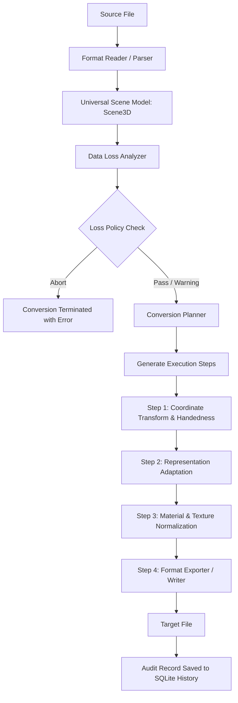

# KIẾN TRÚC HỆ THỐNG CHUYỂN ĐỔI ĐA ĐỊNH DẠNG (CONVERSION ENGINE)
## Universal Multi-Format Conversion Architecture qua Universal Scene Model (USM)

---

## 1. Triết Lý Thiết Kế Cốt Lõi: Hub-and-Spoke qua USM

Trong các hệ thống xử lý 3D truyền thống, việc hỗ trợ $N$ định dạng thường dẫn đến cấu trúc ma trận chuyển đổi trực tiếp $N \times (N - 1)$ kết nối (Pairwise Direct Converters). Mô hình này tạo ra sự bùng nổ độ phức tạp mã nguồn (combinatorial explosion), làm cho việc bảo trì và mở rộng thêm định dạng mới trở nên cực kỳ khó khăn và dễ phát sinh lỗi.

**NEXUS-3D** giải quyết triệt để vấn đề này bằng mô hình **Hub-and-Spoke**, trong đó **Universal Scene Model (USM)** đóng vai trò là "Ngôn ngữ chung" (Universal Intermediate Representation - IR) tại trung tâm:

```
[Wavefront OBJ / MTL] ──┐                                  ┌──> [Wavefront OBJ / MTL]
[Sponge v2 / v3]      ──┼──> [ USM: Scene3D ] ──┼──> [Sponge v2 / v3]
[Legacy Schematic]    ──┤   (Nodes, Meshes,    ├──> [Legacy Schematic]
[Voxel JSON]          ──┤    VoxelGrids,       ├──> [Voxel JSON]
[Bedrock Geometry]    ──┘    Bones, Materials) └──> [Bedrock Geometry]
```

- **Mọi định dạng đầu vào ($In$)** chỉ cần một bộ đọc/nạp (Reader/Parser) để tạo dựng `Scene3D`.
- **Mọi định dạng đầu ra ($Out$)** chỉ cần một bộ trích xuất/ghi (Writer/Exporter) nhận `Scene3D`.
- Khi cần chuyển đổi từ định dạng A sang định dạng B ($A \to B$), luồng dữ liệu bắt buộc tuân thủ:
  $$\text{Source Format } A \longrightarrow \text{USM } (\text{Scene3D}) \xrightarrow{\text{Geometry / Coord Transforms}} \text{USM Target Ready} \longrightarrow \text{Target Format } B$$
- **Tuyệt đối không có mã chuyển đổi trực tiếp $A \to B$** mà không thông qua USM.

---

## 2. Các Thành Phần Kiến Trúc Của Conversion Engine

Conversion Engine được chia tách thành các module tuân thủ nghiêm ngặt **Clean Architecture**:

### 2.1. `NEXUS3D.Conversion.Abstractions`
- Định nghĩa toàn bộ interfaces, enums, và options độc lập với implementation:
  - `IFormatCapabilityRegistry`: Tra cứu tính năng và độ tương thích giữa các định dạng.
  - `IConversionPlanner`: Lập kế hoạch các bước chuyển đổi tuần tự (Execution Steps).
  - `IUniversalConversionPipeline`: Điều phối toàn bộ vòng đời chuyển đổi từ file nguồn sang đích.
  - `ICoordinateConverter`: Chuyển đổi hệ tọa độ, đảo winding order, và bake xương.
  - `IVoxelToMeshConverter`: Chuyển đổi VoxelGrid thành MeshData (Culling & Greedy Meshing).
  - `IMeshToVoxelConverter`: Rasterization 3D biến MeshData thành VoxelGrid (SAT Intersection).
  - `IBedrockCubeToMeshConverter`: Bake cấu trúc phân cấp bone/cube thành MeshData chuẩn.
  - `IPolygonTriangulator`: Tam giác hóa đa giác lồi/lõm thành triangles.
  - `IMaterialMappingService`: Chuẩn hóa vật liệu (PBR $\leftrightarrow$ Phong) và sao chép textures.
  - `IDataLossAnalyzer`: Phân tích rủi ro mất mát dữ liệu trước khi thực thi.
  - `IBatchConversionService`: Xử lý hàng loạt tệp tin đa luồng với kiểm soát concurrency.

### 2.2. `NEXUS3D.Conversion.Domain`
- Lưu trữ các thực thể logic nghiệp vụ của hệ thống chuyển đổi:
  - `FormatFeatureMatrix`: Bảng ma trận năng lực chi tiết của từng định dạng (Voxel, PolygonalMesh, BoneHierarchy, PbrMaterials, CustomBlockState, PerFaceUv).
  - `ConversionAuditTrail`: Thực thể theo dõi lịch sử và kết quả chuyển đổi lưu trữ bền vững.

### 2.3. `NEXUS3D.Conversion.Engine`
- Triển khai cụ thể các thuật toán chuyển đổi hình học và dịch vụ cốt lõi:
  - `CoordinateConversionService`:
    - Biến đổi giữa Left-handed (Y-up, Z-forward) và Right-handed (Y-up, Z-backward).
    - Biến đổi giữa Minecraft World Grid (Right-handed, Y-up) và Standard 3D.
    - Đảo ngược thứ tự đỉnh (Winding order flip) khi phản chiếu trục không gian.
  - `PolygonTriangulator`:
    - Triangulation tối ưu cho Quads (tách 2 tam giác theo đường chéo ngắn nhất).
    - Triangulation tổng quát bằng thuật toán Projected Ear-Clipping sử dụng vector pháp tuyến Newell.
    - Fallback cơ chế Triangle Fan cho các đa giác đơn giản.
  - `VoxelToMeshConverter`:
    - `SimpleBlockQuads`: Sinh 6 mặt lập phương cho mỗi voxel.
    - `ExposedFaceCulling`: Chỉ sinh các mặt tiếp giáp với không khí hoặc biên voxel grid, giảm đến 70% số lượng polygon.
    - `GreedyMeshing`: Thuật toán gộp các mặt đồng phẳng cùng vật liệu theo lát cắt 3D (2D slice sweep), giảm tới 90% số lượng quads.
  - `MeshToVoxelConverter`:
    - Thuật toán 3D AABB-Triangle SAT (Separating Axis Theorem của Tomas Akenine-Möller).
    - Tối ưu hóa không gian tìm kiếm bằng voxel bounding box cho từng tam giác.
    - Tự động lấy mẫu vật liệu/màu sắc từ đỉnh tam giác để gán BlockState hoặc Voxel Material tương ứng.
    - Tùy chọn Solid Fill bằng thuật toán Flood Fill 3D từ bên trong lòng thể tích khép kín.
  - `BedrockCubeToMeshConverter`:
    - Duyệt cây phân cấp xương (Bone Hierarchy).
    - Tính toán Ma trận Thế giới (World Transformation Matrix) có kiểm soát chu trình (cycle detection).
    - Áp dụng thông số `inflate`, `mirror`, và ánh xạ UV (Box UV hoặc Per-face UV).
  - `MaterialMappingService`:
    - Chuyển đổi thuộc tính vật liệu giữa PBR (Albedo, Roughness, Metallic) và Phong/Blinn-Phong (Diffuse, Specular, Shininess).
    - Tự động sao chép các tệp ảnh texture sang thư mục đích và cập nhật đường dẫn tương đối trong model xuất ra.
  - `DataLossAnalyzer`:
    - So sánh ma trận tính năng giữa Source và Target.
    - Cảnh báo các mất mát tiềm tàng: mất cấu trúc xương khi chuyển sang Schematic, mất chi tiết bề mặt khi voxelize, giảm cấp vật liệu.
    - Áp dụng chính sách kiểm soát lỗi: `AllowWithWarning`, `AbortOnLoss`, hoặc `InteractivePrompt`.
  - `UniversalConversionPipeline`:
    - Điều phối toàn bộ luồng: Parser $\to$ USM $\to$ Data Loss Analysis $\to$ Plan Generation $\to$ Step Execution $\to$ Exporter.

### 2.4. `NEXUS3D.Conversion.Batch`
- Cung cấp dịch vụ `BatchConversionService`:
  - Kiểm soát tài nguyên bằng `SemaphoreSlim(maxDegreeOfParallelism)`.
  - Báo cáo tiến độ chi tiết theo thời gian thực (`IProgress<BatchProgressReport>`).
  - Hỗ trợ hủy tác vụ an toàn bằng `CancellationToken`.

---

## 3. Quy Trình Chuyển Đổi Chi Tiết (Pipeline Flow)



### Các bước thích ứng biểu diễn hình học (Representation Adaptation):
1. **Mesh $\to$ Voxel (Voxelization)**:
   - Áp dụng khi Target là Voxel JSON hoặc Schematic, nhưng Source lại chứa MeshData (ví dụ OBJ).
   - Thực hiện rasterization qua `IMeshToVoxelConverter`.
2. **Voxel $\to$ Mesh (Meshing)**:
   - Áp dụng khi Target là OBJ hoặc Bedrock Geometry, nhưng Source chỉ chứa VoxelGrid (ví dụ Schematic).
   - Thực hiện trích xuất bề mặt với `GreedyMeshing` qua `IVoxelToMeshConverter`.
3. **Bedrock Bones/Cubes $\to$ Mesh (Baking)**:
   - Áp dụng khi Source là Bedrock Geometry chứa phân cấp Bone/Cube và đích đến là OBJ hoặc Voxel.
   - Thực hiện flatten cây phân cấp bằng `IBedrockCubeToMeshConverter`.

---

## 4. Bảng Ma Trận Tương Thích & Tính Năng Giữa Các Định Dạng

| Định Dạng | Voxel Support | Mesh Support | Skeleton / Bones | Materials | Coordinate System |
|---|---|---|---|---|---|
| **Sponge Schematic (v2/v3)** | Native 3D Paletted Grid | Qua Voxelization | Không | Minecraft BlockStates | Right-handed (Y-up) |
| **Legacy Schematic** | 3D BlockID/Data Grid | Qua Voxelization | Không | Legacy Block IDs | Right-handed (Y-up) |
| **Wavefront OBJ / MTL** | Qua Meshing | Native Polygon Mesh | Không | MTL Phong / Textures | Right-handed (Y-up) |
| **Voxel JSON** | Native Dialects | Qua Voxelization | Không | Custom / Palette | Tùy biến / Y-up |
| **Bedrock Geometry** | Qua Voxelization | Native Cubes / PolyMesh | Native Bone Hierarchy | Box UV / Per-face UV | Left-handed (Y-up) |

---

## 5. Tích Hợp Giao Diện Người Dùng & Lưu Trữ Lịch Sử

- **Converter Workspace (`ConverterViewModel`)**:
  - Tích hợp điều khiển luồng chuyển đổi đơn và chuyển đổi hàng loạt.
  - Cho phép người dùng tùy chọn giải thuật meshing (`GreedyMeshing`, `ExposedFaceCulling`, `SimpleBlockQuads`), độ phân giải voxelize, chính sách cảnh báo mất mát dữ liệu, và thư mục xuất.
  - Báo cáo tiến độ và nhật ký thực thi trực tiếp trên giao diện MVVM.
- **SQLite Audit Logging (`IConversionHistoryRepository`)**:
  - Mỗi tác vụ chuyển đổi thành công hoặc thất bại đều được tự động lưu vết vào cơ sở dữ liệu SQLite cục bộ (`nexus3d.db`), bao gồm:
    - Đường dẫn nguồn và đích, định dạng nguồn/đích.
    - Thời gian bắt đầu, thời gian thực thi (ms).
    - Trạng thái thành công / mã lỗi.
    - Kích thước tệp và chi tiết các cảnh báo mất mát dữ liệu (Loss Items).
