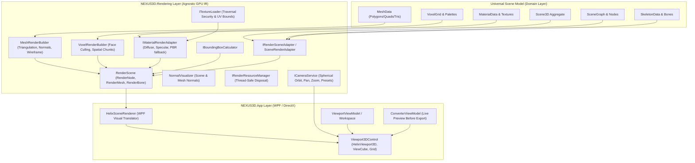

# NEXUS-3D: 3D Rendering Engine & Universal Viewport Architecture

## 1. Architectural Overview

The **NEXUS-3D Rendering Engine** provides a high-performance, hardware-accelerated 3D viewport embedded directly into the WPF desktop client running on **.NET 10 LTS**. 

Following Clean Architecture principles, the core domain model (`Scene3D` / Universal Scene Model) remains strictly pure, devoid of any framework-specific UI elements, graphics contexts, or GPU handle allocations. Instead, the rendering pipeline operates via an adapter layer that compiles USM snapshots into an optimized, GPU-ready intermediate representation (`RenderScene`), which is subsequently translated into native WPF / Helix Toolkit 3D visuals.



---

## 2. Rendering Subsystems & Components

### 2.1. Clean Architecture Separation & `RenderScene`
The `NEXUS3D.Rendering` assembly is decoupled from the WPF UI library. It defines the intermediate representation:
- **`RenderScene`**: Point-in-time immutable rendering snapshot with precomputed bounding box (`BoundsMin`, `BoundsMax`), aggregate vertex/triangle/voxel statistics, and hierarchical nodes.
- **`RenderNode`**: Node tree mirroring the USM hierarchy, containing local and world 4x4 transform matrices (`Matrix4x4`), associated meshes, voxel chunks, and child nodes.
- **`RenderMesh`**: GPU-ready vertex buffer arrays: `Vector3[] Positions`, `Vector3[] Normals`, `Vector2[] UVs`, `Vector4[] Colors`, `int[] Indices` (triangles), and `int[] WireframeIndices` (line edges).
- **`RenderVoxelChunk`**: Partitioned 16x16x16 spatial chunk containing voxel count and pre-culled render mesh.
- **`RenderBone`**: Articulated bone node with local transform, world matrix, pivot position, and hierarchy linkages for skeleton visualization.

### 2.2. Viewport & Hardware Acceleration (`Viewport3DControl`)
- Built upon `HelixToolkit.Wpf 3.1.2`, providing DirectX hardware-accelerated WPF 3D rendering.
- Features:
  - Interactive ViewCube for intuitive orientation.
  - 3D coordinate system axes indicator (X = Red, Y = Green, Z = Blue).
  - Infinite grid floor visualizer (`GridLinesVisual3D`).
  - Dual camera projection mode: Perspective (field of view 45°) and Orthographic.
  - Interactive ray-mesh hit testing (`Viewport3DHelper.HitTest`) for precision object selection with bounding box highlighting.

### 2.3. Camera Service & Navigation Mathematics (`CameraService`)
- Spherical orbit math with gimbal-lock prevention (pitch clamped to $\pm 85^\circ$ / $\pm 89^\circ$).
- Pan navigation calculated orthogonally along the camera's local forward, right, and up vectors, proportional to camera distance.
- Exponential zoom scaling with near/far distance clamping.
- Preset orientations: Front, Back, Left, Right, Top, Bottom, and Isometric.
- Bounding-sphere framing (`FocusBounds`): Computes ideal distance $d = \frac{r}{\sin(\text{FOV} / 2)} \times 1.35$ to automatically frame any model within view.

### 2.4. Polygon Triangulation & Mesh Builder (`MeshRenderBuilder`)
- Triangulates arbitrary USM polygon faces:
  - Triangles: Preserved directly (3 indices).
  - Quads: Split into two triangles $(0, 1, 2)$ and $(0, 2, 3)$.
  - N-gons: Triangulated using fan triangulation $(0, i, i+1)$.
- Automatic flat normal synthesis fallback when mesh normals are omitted.
- Generates wireframe edge indices $(i, i+1)$ for crisp topology inspection.

### 2.5. Voxel Rendering & Exposed Face Culling (`VoxelRenderBuilder`)
- **Exposed Face Culling**: Prior to generating cube geometry, adjacent neighbors $(\pm X, \pm Y, \pm Z)$ are tested in discrete voxel space. Only external faces exposed to air/boundary are generated, eliminating ~95% of hidden geometry in dense voxel structures.
- **Spatial Chunking**: For large voxel structures (such as Minecraft schematics exceeding 32,000 voxels), voxels are partitioned into localized 16x16x16 spatial chunks to optimize rendering and spatial culling.
- **Deterministic Palette Color Hashing**: Automatically derives distinguishable, consistent RGB hues from block namespace IDs when custom textures are unavailable.

### 2.6. Texture Loading & Path Traversal Security (`TextureLoader`)
- Prevents directory traversal attacks (`../`, `..\`) by validating canonical full paths against the root workspace directory before loading image resources.
- Supports standard 3D formats: PNG, JPG, BMP, TGA, WEBP.
- Analyzes UV bounds to detect whether texture tiling/wrapping is required ($U > 1.0$ or $V > 1.0$).
- WPF UV convention handling: Inverts the V axis ($1.0 - V$) to align standard 3D texture space with DirectX/WPF screen coordinates.

### 2.7. Bone Hierarchy & Skeleton Visualization
- Extracts articulated bone hierarchies from USM `SkeletonData`.
- Computes accumulated world transforms: $\mathbf{M}_{\text{world}} = \mathbf{M}_{\text{local}} \times \mathbf{M}_{\text{parent}}$.
- Draws 3D bone linkage lines between parent and child pivot points.

### 2.8. Resource Lifecycle & GPU Memory Management (`RenderResourceManager`)
- Thread-safe resource dictionary (`ConcurrentDictionary<string, object>`) tracking native brushes, textures, and geometry buffers.
- Automatic disposal on scene change or viewport unload to prevent WPF memory leaks.

---

## 3. Dependency Injection Configuration

All rendering services are registered via `RenderingServiceRegistration.AddNexusRendering()`:

```csharp
public static IServiceCollection AddNexusRendering(this IServiceCollection services)
{
    services.AddSingleton<IBoundingBoxCalculator, BoundingBoxCalculator>();
    services.AddSingleton<ITextureLoader, TextureLoader>();
    services.AddSingleton<IMaterialRenderAdapter, MaterialRenderAdapter>();
    services.AddSingleton<MeshRenderBuilder>();
    services.AddSingleton<VoxelRenderBuilder>();
    services.AddSingleton<NormalVisualizer>();
    services.AddSingleton<IRenderResourceManager, RenderResourceManager>();
    services.AddSingleton<ICameraService, CameraService>();
    services.AddSingleton<IRenderSceneAdapter, SceneRenderAdapter>();
    services.AddSingleton<IRenderService, RenderService>();
    return services;
}
```
