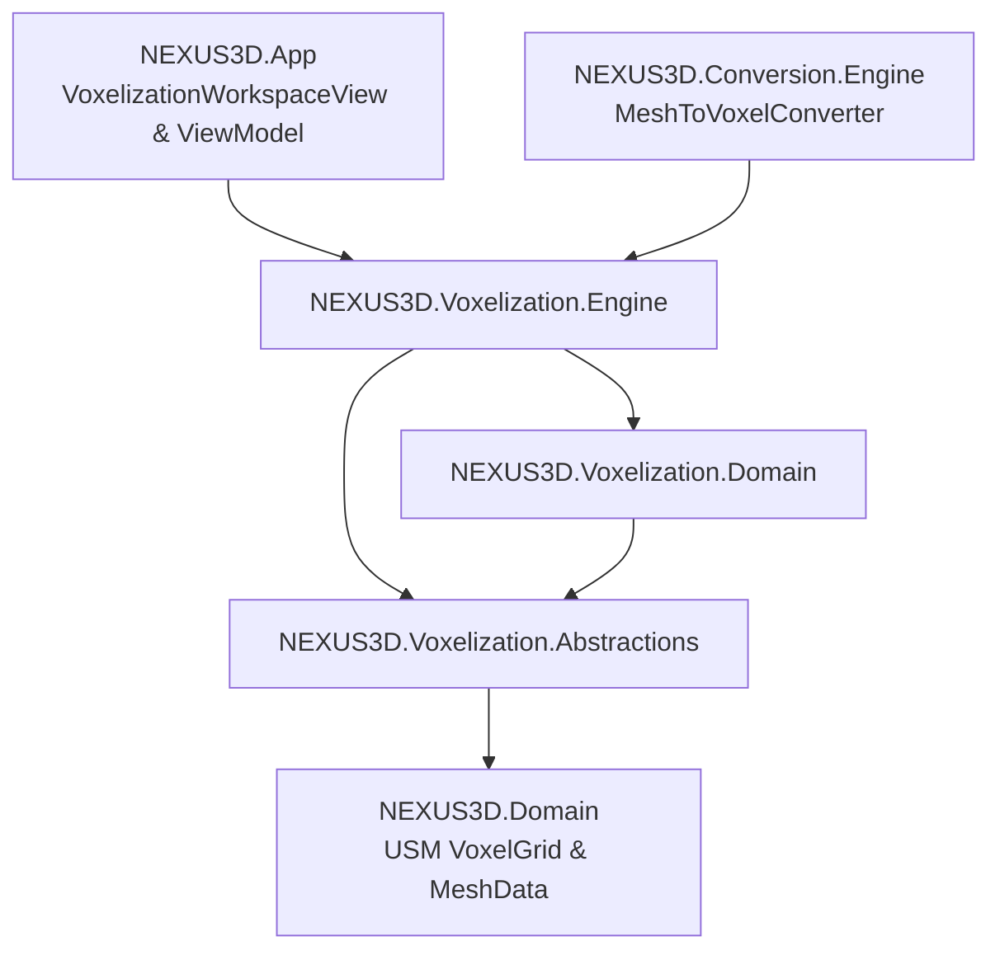

# NEXUS 3D – Voxelization Engine Architecture Specification

## 1. Giới thiệu tổng quan

**Voxelization Engine (Giai đoạn 08)** là hệ thống chuyển đổi mô hình 3D liên tục (Continuous Polygon Mesh) thành dạng thể tích rời rạc (Discrete Volumetric Voxel Model) tích hợp trực tiếp vào **Universal Scene Model (USM)** của NEXUS 3D.

Hệ thống cho phép nhập mô hình đa giác (Wavefront OBJ, MTL, Meshes) và chuyển đổi thành:
1. `VoxelGrid` – Cấu trúc lưới voxel trung gian USM với bảng palette và không gian tọa độ 3D.
2. `VoxelCuboid` – Danh sách các khối hộp thể tích (Axis-Aligned Bounding Box) được tối ưu hóa bằng thuật toán Gom cụm Tham lam 3D (Greedy 3D Cuboid Merging).

---

## 2. Kiến trúc tổng thể và Clean Architecture

Voxelization Engine tuân thủ nghiêm ngặt nguyên lý Clean Architecture và Modular Architecture:

### Các Project thành phần:
- **`NEXUS3D.Voxelization.Abstractions`**:
  - Contracts & Interfaces: `IVoxelizationEngine`, `IVoxelizationAlgorithm`, `IVoxelizationValidator`, `IVoxelToCuboidConverter`.
  - Enums: `VoxelizationMode`, `VoxelResolutionMode`, `ColorSamplingMode`, `VoxelGridAlignment`.
  - Models: `VoxelCuboid`, `CuboidOptimizationResult`, `VoxelizationResult`, `VoxelizationStatistics`, `VoxelizationWarning`.
- **`NEXUS3D.Voxelization.Domain`**:
  - `VoxelizationSettings`: Thiết lập cấu hình tham số chuyển đổi (kích thước voxel, giới hạn lưới, chế độ lấy mẫu màu, dọn dẹp hình học).
- **`NEXUS3D.Voxelization.Engine`**:
  - `Geometry`:
    - `TriangleBoxIntersection`: Triển khai định lý trục phân tách (Separating Axis Theorem – SAT) 13 trục theo Tomas Akenine-Möller với hệ số giãn nở (dilated SAT).
    - `SpatialIndex`: Ánh xạ vùng hộp giới hạn tam giác sang chỉ số ô voxel rời rạc để loại trừ sớm các phép kiểm tra không giao nhau.
    - `MeshBoundsCalculator`: Tính toán bounds và ma trận biến đổi.
  - `Processing`:
    - `MeshPreprocessor`: Kiểm tra tính hợp lệ của mesh, phát hiện cạnh hở phi đa tạp (non-manifold open boundary), lọc tam giác suy biến (degenerate/collinear).
    - `ConnectedComponentAnalyzer`: Phân tích thành phần liên thông của đồ thị lưới.
    - `VoxelColorSampler`: Lấy mẫu màu bằng tọa độ trọng tâm (Barycentric projection), nội suy màu đỉnh và texture UV.
    - `VoxelMaterialMapper`: Quản lý Palette và bầu chọn vật liệu chiếm diện tích bề mặt lớn nhất (dominant material area selection).
    - `VoxelOptimizationService`: Cắt tỉa voxel cô lập không có láng giềng và lấp đầy các lỗ hổng rỗng 1-cell có 5-6 mặt láng giềng.
  - `Conversion`:
    - `VoxelToCuboidConverter`: Thuật toán gom cụm thể tích tham lam 3D dọc theo các trục X, Y, Z bảo toàn 100% thể tích và tách biệt ranh giới vật liệu.
  - `Algorithms`:
    - `SurfaceVoxelization`: Voxelization bề mặt qua SAT.
    - `SolidVoxelization`: Voxelization thể tích đặc kết hợp vỏ ngoài SAT và thuật toán BFS 3D Flood Fill từ không gian đệm bên ngoài.
    - `ConservativeVoxelization`: Voxelization bảo toàn với SAT mở rộng biên.
    - `AdaptiveVoxelization`: Voxelization thích ứng chi tiết.
  - `DependencyInjection`: Extension method `AddNexusVoxelization()`.

---

## 3. Thuật toán chi tiết

### 3.1. Phép thử giao cắt Tam giác – Hộp (Tomas Akenine-Möller SAT 13 Trục)
Kiểm tra 13 trục độc lập:
- 3 trục pháp tuyến mặt hộp AABB: $e_0 = (1, 0, 0), e_1 = (0, 1, 0), e_2 = (0, 0, 1)$.
- 1 trục pháp tuyến mặt phẳng tam giác: $n = (v_1 - v_0) \times (v_2 - v_0)$.
- 9 trục tích có hướng giữa 3 cạnh tam giác và 3 trục hộp: $u_i \times e_j$ ($i, j \in \{0, 1, 2\}$).

Nếu tồn tại bất kỳ trục nào mà khoảng chiếu của tam giác và hộp không chồng lấn, thuật toán trả về `false`.

### 3.2. Voxelization thể tích đặc (Solid Voxelization)
1. Thực hiện Surface Voxelization để tạo lớp vỏ biên khép kín.
2. Thiết lập lưới không gian đệm mở rộng $[-1..DimX] \times [-1..DimY] \times [-1..DimZ]$.
3. Kích hoạt hàng đợi BFS 3D Flood-fill từ điểm góc ngoài đệm $(-1, -1, -1)$.
4. Các ô thuộc bề mặt tam giác đóng vai trò rào chắn ngăn cản dòng flood-fill.
5. Tất cả các ô không thuộc lớp ngoài và không nằm trên bề mặt được đánh dấu là thể tích bên trong (Interior) và được lấp đầy bằng vật liệu lõi.
6. Nếu mesh đầu vào không kín (hở/phi đa tạp), hệ thống tự động phát ra cảnh báo `VOX_OPEN_MESH`.

### 3.3. Thuật toán Gom cụm Tham lam 3D (Greedy 3D Cuboid Merging)
Để tối ưu hóa số lượng khối xuất ra cho các định dạng Minecraft Schematic, Bedrock Geometry, và giảm tải render GPU:
1. Nhóm các voxel theo từng chỉ số vật liệu `PaletteIndex`.
2. Khởi tạo mảng đánh dấu `visited`.
3. Duyệt từ góc nhỏ nhất $(x, y, z)$ chưa thăm:
   - Mở rộng tối đa theo trục X dọc theo các voxel cùng vật liệu chưa thăm.
   - Mở rộng dải theo trục Y nếu toàn bộ dải X tương ứng có cùng vật liệu và chưa thăm.
   - Mở rộng phiến theo trục Z nếu toàn bộ mặt phẳng $X \times Y$ tương ứng có cùng vật liệu và chưa thăm.
4. Đóng gói thành `VoxelCuboid(MinPosition, MaxPosition, PaletteIndex)`.
5. Đánh dấu tất cả ô thuộc khối là đã thăm.
6. Đạt tỉ lệ giảm tải phần tử từ 80% đến 99% mà không làm mất bất kỳ voxel hay vật liệu nào.

---

## 4. Tích hợp Pipeline và Giao diện WPF

1. **Pipeline Chuyển đổi**: `MeshToVoxelConverter` trong `NEXUS3D.Conversion.Engine` tự động ủy quyền xử lý cho `IVoxelizationEngine` khi cấu hình chuyển đổi đa giác sang Schematic hoặc Voxel JSON.
2. **3D Viewport**: `HelixSceneRenderer` hỗ trợ hiển thị lưới voxel theo chunk với màu đỉnh được nội suy trực tiếp từ mô hình gốc.
3. **Workspace WPF**: Giao diện `VoxelizationWorkspaceView` cung cấp 5 khu vực làm việc:
   - Panel chọn tệp mesh và thông tin tổng quát.
   - Panel thiết lập thông số thuật toán (chế độ, kích thước, lấy mẫu màu, dọn dẹp).
   - Viewport 3D tương tác thời gian thực với thanh tiến trình và hủy tác vụ.
   - Panel thống kê chi tiết (số voxel, số cuboid, tỉ lệ nén, thời gian thực thi).
   - Panel chuẩn đoán hình học và danh sách cảnh báo.
